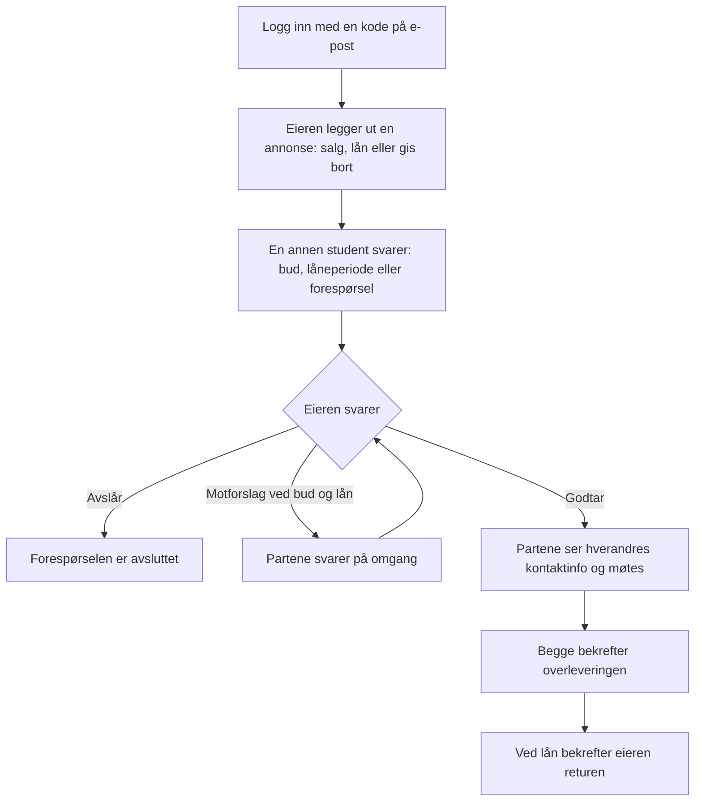

# Studentmarkedet

Studentmarkedet er en markedsplass der studenter kan kjøpe, selge, låne og gi bort ting som bøker,
PC-er og annet utstyr. Den fungerer som Finn.no, men bare for studenter ved samme skole, og i dag er
den åpen for Høgskolen i Østfold. Appen kjører på https://studentmarkedet.org.

Prosjekt i ITF31619 Webapplikasjoner 26H, gruppe W-13: Max og Emil.

## Slik fungerer det



Partene får varsel på e-post underveis.

## Oversikt over koden

Koden ligger i `app/src/`. Hver funksjon har sin egen mappe under `app/src/app/`, med sider,
komponenter, regler og datalag samlet.

| Hva | Hvor |
|---|---|
| Ruter og middleware | `app/src/worker.tsx` (alle rutene) |
| Tilgang | `app/src/app/auth/guards.ts` og `session.ts` |
| Funksjonene | `auth`, `listings`, `requests`, `favorites`, `me`, `home`, `images`, `notifications` |
| Sider og komponenter | `.tsx`-filene i funksjonsmappen, delte komponenter i `shared/` |
| Server actions (skriving) | `actions.ts` i funksjonsmappen |
| REST-endepunkt (søk) | `GET /api/listings` i `listings/api.ts` |
| Regler (service) | Egne filer i funksjonsmappen, for eksempel `requests/place-bid.ts` og `respond.ts` |
| Datalag (repository) | `repository.ts` i funksjonsmappen, det eneste som snakker med databasen |
| Databaseskjema | `app/src/db/schema.ts`, migrasjoner i `app/drizzle/` |
| Tester | `*.test.ts(x)` ved siden av koden, nettlesertester i `app/e2e/` |

Tre valg preger koden:

- **Feature-mapper:** vi jobber ofte med én funksjon om gangen, så alle filene som hører til en
  funksjon ligger samlet, i stedet for å dele etter type.
- **Server actions og REST:** vi bruker server actions for det som ellers kunne blitt gjort med POST,
  og REST når vi skal hente ting dynamisk uten å laste siden på nytt, for eksempel ved søk.
- **Tilgang på tre steder:** rutevakten sjekker sidebesøk, hver server action sjekker innloggingen på
  nytt, og repositoryet finner bare det som er knyttet til brukerens id.

## Kom i gang

Bruk Node **24.19.0** og npm **11.17.0**. Kjør fra repo-roten:

```powershell
cd app
npm ci
npx playwright install chromium
npm run db:migrate:local
npm run db:seed:local
npm run dev
```

Logg inn med testbrukeren `test.testesen@hiof.no`. Innloggingskoden kommer i terminalen der
`npm run dev` kjører, for eksempel i VS Code.

Testene kjøres fra `app/`:

| Oppgave | Kommando |
|---|---|
| Enhets- og integrasjonstester | `npm test` |
| Dekning (feiler under 50 %) | `npm run test:coverage` |
| Nettlesertester (bygg først med `npm run build`) | `npm run test:e2e` |
| Hele kontrollrekken, som i CI | `npm run check` |

Målt dekning 04.11.2026: linjer 75,2 %, setninger 74,3 %, grener 74,2 %, funksjoner 66,8 %.

## Endringslogg

| Dato | Hva |
|---|---|
| 04.11 | Felles sesjonsvakt for alle server actions, dekningsterskel på 50 % og strammere CSP |
| 03.11 | Repository i hver funksjonsmappe: bare repositoryet snakker med databasen |
| 02.11 | Omfanget ble avgrenset til MVP (#223); chat og tjenester kommer ikke i denne versjonen |
| 01.11 | E-postvarsler til motparten |
| 24.10 | Favoritter og Mine annonser |
| 16.10 til 21.10 | Bud, lån, gis bort, motforslag, overlevering og retur |
| 11.10 | Bilder i R2 |
| 10.10 | Søk og REST-endepunktet |
| 07.10 til 08.10 | Appen på nett på eget domene, med automatisk deploy fra `main` |
| 05.10 | Innlogging med engangskode på e-post |

Hele loggen står i [`docs/endringslogg.md`](docs/endringslogg.md), og resten av dokumentasjonen i
[`docs/`](docs/README.md). KI-bruken følger [KI-avtalen](docs/prosess/ki-avtale.md).
