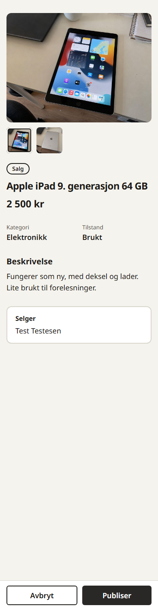
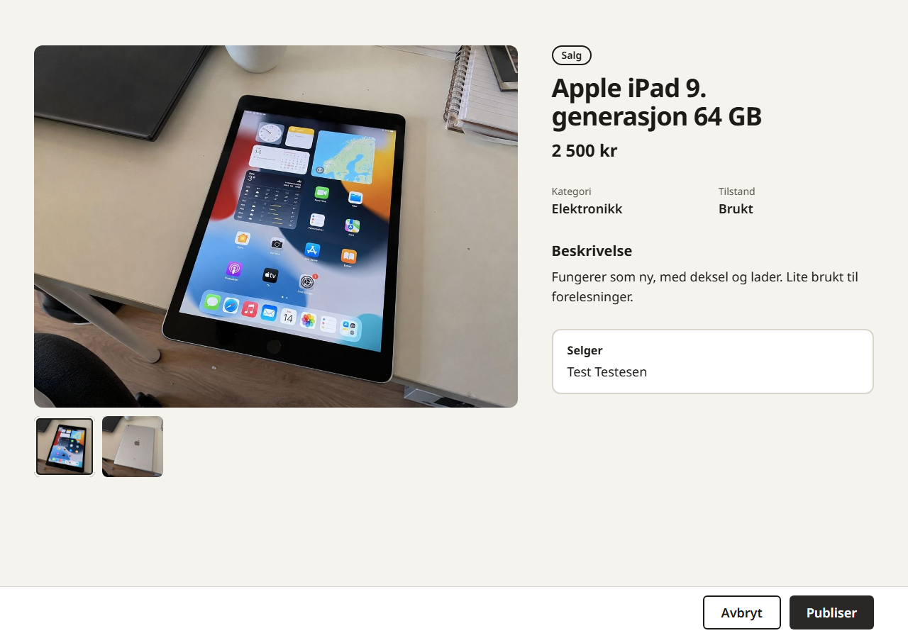

# Wireframes og skjermspesifikasjon

**Laget 29.09.2026** med Claude Design i Claude Code, etter Max sine valg underveis.
Emil har ikke gjennomgått innholdet ennå. Dette dokumentet er byggegrunnlaget for
skjermene. Det er ikke implementert kode. Beslutningene nedenfor er også ført inn i
[kravspesifikasjonen](../../krav/kravspesifikasjon.md) (29.09.2026), som eier kravene.

- **Redigerbart lerret:** <https://claude.ai/artifact/CnhymdWdfZZRhE5t6VTtE7>
  (privat, må deles fra Share-menyen før andre kan åpne det). Lerretet åpner i
  «Gjennomgang», en lysbildevisning av hovedflyten med bryter for mobil og desktop.
- **Bilder:** [png/](png/) har én PNG per skjerm, mobil (390 px) og desktop (1280–1440 px). Unntak: `Legg-ut-forhandsvis-*` er
  skjermbilder av den bygde dialogen 12.10.2026 (#171), ikke fra lerretet.
- **Kildefiler:** [kilde/](kilde/) er en kopi av lerretet (`.dc.html` per skjerm og
  `canvas.json`) per 29.09.2026. Lerretet er fasiten hvis de to spriker.
- **Sign-off:** [rapporten](../../leveranser/sign-off/rapport.pdf) viser et utvalg av skjermene.
  Kilden er [rapport.html](../../leveranser/sign-off/rapport.html).
- **Eksportere på nytt** etter endringer på lerretet: last ned filene til `kilde/`, og kjør
  fra repo-roten `node scripts/wireframes-til-png.mjs <abs>/docs/wireframes/kilde <abs>/docs/wireframes <abs>/app`
  og `node scripts/html-til-pdf.mjs <abs>/docs/sign-off/rapport.html <abs>/docs/sign-off/rapport.pdf <abs>/app`,
  der `<abs>` er full sti til repoet. Skriptene bruker Playwright fra `app/` og rendrer lokalt.

## Beslutninger fra wireframe-arbeidet

Avklart av Max 29.09.2026. Disse erstatter eldre varianter i notatet
`School/kravdiskusjon.md` der de spriker, og er ført inn i kravspesifikasjonen.

| Tema | Beslutning |
|---|---|
| Innlogging | Bare e-post, ingen passord. Appen sender en sekssifret engangskode, ingen lenke (endret 05.10). Kun `@hiof.no`. Samme flyt for ny og eksisterende konto. Løsning: better-auth. Regler og grenser står i [kravspesifikasjonen](../../krav/kravspesifikasjon.md). |
| Kontooppsett | Ny bruker fyller inn fullt navn, land og telefon én gang. Navn kan ikke hentes fra e-postadressen. |
| Tilgang | Innlogging kreves før annonser kan ses eller søkes i. |
| Handelstyper | Salg, lån og gis bort. Én type per annonse. Lån har valgfri ukepris (tom betyr gratis). |
| Forespørsel ved salg | Bare et bud i kroner. Mottakeren godtar, avslår eller foreslår en annen pris, på omgang. |
| Forespørsel ved lån | Bare en periode (fra og til), minst én uke. Opptatte datoer kan ikke velges. |
| Gis bort | Som salg, men uten bud: forespørsel, eier godtar, begge bekrefter overlevering. Ingen retur. Skjermen for selve forespørselen er ikke tegnet. |
| Sted og tid | Ikke i appen. Partene avtaler overlevering på telefon eller e-post etter aksept. |
| Kontaktinfo | Telefon og e-post vises først for motparten etter godtatt forespørsel. |
| Overlevering | Begge bekrefter. Salget er fullført når begge har bekreftet. |
| Forlengelse | Begge kan foreslå ny returdato. Standardforslag er dagen etter nåværende returdato. |
| Retur | Bare eieren bekrefter retur ved lån. |
| Pris for lån | Ukepris delt på 7, ganget med antall dager. |
| Frister | Ubesvart forespørsel utløper etter 7 dager. Har bare én part bekreftet overlevering, regnes den som bekreftet etter 3 dager. |
| Returrapporter | Bare den som skrev og admin kan lese dem. Admin kontakter partene ved behov. |
| Bilder | Sannsynligvis Cloudflare R2, muligens D1. Ikke endelig valgt. |
| Min side | Én side med profil (bilde, navn, e-post, telefon) og fanene Mine annonser, Forespørsler og Historikk. Mine favoritter er lagt til 24.10 (#224). Rediger profil og logg ut ligger under profilen. |
| Hovedmeny | Annonser, Min side, Legg ut annonse. |
| API-stil | REST-endepunkter for lesing (T03), server actions for all skriving med tilgangskontroll i handleren (T04). |

## Felles regler for alle skjermer

- Alle skjermer finnes i mobil- og desktopversjon, med samme innhold.
- Gråtoner i wireframes betyr ikke endelig farge. Tekst skal være stor og lesbar,
  klikkflater minst 44 px, synlig tastaturfokus og etiketter på alle felt (KK-04, DK-03).
- Feil vises ved feltet og i en oppsummering øverst. Utfylt innhold beholdes (KK-03).
- Den stiplede merkelappen «Visning: …» øverst i wireframes er en merknad, ikke en del av appen.
- Plassholdere i hakeparentes, som `[Appnavn]` og `[Kategori]`, er ikke bestemt.

## Foreslått datamodell

Forslag som dekker skjermene. Ikke et vedtatt Drizzle-skjema (T02). Kode, tabeller, felt,
statuser, ruter og komponentnavn er på engelsk; teksten brukerne ser, er på norsk (Max 29.09).

| Tabell | Felt | Merknad |
|---|---|---|
| `user` | id, email (unik, `@hiof.no`), name, phone, image, created_at | Utvider better-auth sin brukertabell. `name` og `phone` er tomme til kontooppsett er fullført. |
| `listing` | id, owner_id, type (`sale`, `loan`, `giveaway`), title, description, category, condition (`new`, `like_new`, `used`), price, status (`active`, `sold`, `unpublished`), created_at | `price` er heltall i kroner. Salg: pris. Lån: ukepris eller tom. Gis bort: tom. |
| `listing_image` | id, listing_id, key, position | Bygget 11.10 (#138). 1–10 per annonse; `key` er filens plass i R2 (`listings/<annonse>/<uuid>.<jpg/png/webp>`), `position` 0 er forsidebildet. |
| `request` | id, listing_id, requester_id, status, owner_confirmed, requester_confirmed, created_at | Status: `waiting_owner`, `waiting_requester`, `accepted`, `declined`, `withdrawn`, `expired`, `cancelled`, `in_use`, `completed`. |
| `offer` | id, request_id, sender_id, price, start_date, end_date, created_at | Hvert bud, motbud og forlengelse. Siste rad er gjeldende. Eldre rader er historikk. |
| `favorite` | user_id, listing_id, created_at | Bygget 24.10 (#224). Paret `user_id`, `listing_id` er nøkkelen, så det blir aldri to rader for samme bruker og annonse. Raden slettes ikke når annonsen selges eller tas ned; fanen viser bare `active`. |
| `issue_report` | id, request_id, sender_id, type, description, created_at | Returproblem (WV-02). Lagres som påstand, avgjør ingenting. |

## REST-endepunkter (lesing)

Alle krever gyldig sesjon og svarer 401 uten.

| Metode og sti | Brukes av | Svar |
|---|---|---|
| `GET /api/listings?q=&limit=` og filtrene | WF-03, #104 | Bygget 10.10 (#98, T03; filtre #102). 200 med `{ listings: [{ id, title, type, price, status, coverUrl }] }`, best treff først; `q` søker feiltolerant i tittel, beskrivelse og selgerens navn, `limit` (1–50) begrenser antallet, uten `limit` alle treff. Godtar også forsidens filtre `category`, `type` og `condition` (kan gjentas), `minPrice` og `maxPrice`. 400 ved søk over 100 tegn, ukjent filterverdi, «fra» over «til» eller ugyldig `limit`, 401 uten økt, 403 uten fullført kontooppsett, 405 for andre metoder enn GET. Feil svarer `{ error: "norsk melding" }`. Bare de seks feltene sendes. `coverUrl` er adressen til miniatyren av forsidebildet (`/images/...thumb.jpg`) eller `null` (#150, #155). `available` og «ledig fra» kommer med #100. |
| `GET /images/listings/:listingId/:file` | WF-03, WF-04, WF-05 | Bygget 11.10 (#138). Bildet fra R2 med riktig innholdstype og `Cache-Control: private, max-age=31536000, immutable`. `<uuid>.thumb.jpg` er miniatyren av `<uuid>.<jpg/png/webp>` (#155); finnes den ikke, sendes originalen. 401 uten økt, 404 for ukjent bilde eller adresse som ikke har formatet vi lager. |
| `GET /api/listings/:id` | WF-04 | 200 med annonse, bilder, eierens fulle navn og opptatte perioder, også for solgte annonser (Max 08.10). 404 hvis den ikke finnes eller er tatt ned. Telefon og e-post sendes aldri med. |
| `GET /api/requests?direction=received\|sent` | WF-07 | 200 med brukerens egne forespørsler og siste forslag. |
| `GET /api/requests/:id` | WF-08 | 200 bare for de to partene, ellers 404. Kontaktinfo bare når status er `accepted`, `in_use` eller `completed`. |
| `GET /api/me/listings`, `GET /api/me/history` | WF-09 | 200 med egne annonser eller fullførte avtaler. |

## Server actions (skriving)

Hver action sjekker sesjon, rolle og gjeldende status i handleren. Avvist handling
endrer ingenting i databasen.

| Action | Hvem | Regler |
|---|---|---|
| `completeAccount` | Ny bruker | Navn og telefon påkrevd og gyldige. |
| `createListing`, `updateListing` | Innlogget bruker / eier | `createListing` bygget 11.10 (#131): tittel 3–80 tegn, beskrivelse påkrevd (høyst 2000), kjent kategori, handelstype og tilstand. Pris: salg påkrevd heltall 0–100 000, lån valgfri (tom = gratis), gis bort alltid tom. Eier fra økten, aldri fra skjemaet; uten økt til `/login`, uten kontooppsett til `/account-setup`; ved suksess til `/listings/:id?publisert=1`. Bilder (1–10) kommer med #61. Bare eier kan redigere: bygget 24.10 (#229) som reglene `updateListingFields` og serverhandlingen `updateListing`. Handelstypen leses fra databasen, ikke skjemaet; samme feltregler som ved publisering; bare egen aktiv annonse, også i selve oppdateringen. Bildene endres ikke ennå. Ved suksess til `/listings/:id`. |
| `unpublishListing` | Eier | Tar annonsen ut av søket. Endrer ikke eksisterende avtaler. Bygget 24.10 (#229) som reglene `unpublishListing` og serverhandlingen `takeDownListing`: bare eierens egen aktive annonse, med en betinget oppdatering. Ventende forespørsler avslås (Max 24.10); godtatte og lån i bruk røres ikke. Knappen kommer i neste PR. |
| `sendRequest` | Innlogget bruker | Ikke egen annonse, annonsen er aktiv. Salg: bud > 0. Lån: minst 7 dager, ingen overlapp med godtatte lån. Salg er bygget 17.10 (#185) som `sendBid` (serverhandlingen) og `placeBid` (reglene): bud fra 1 til 100 000 kr, én pågående forespørsel per student per annonse (delvis unik indeks), og et nytt bud mens selgeren ikke har svart legger en ny `offer`-rad på samme forespørsel. Lån og gis bort er bygget 20.10 (#186a) som `placeRequest` (reglene, felles med `placeBid`) og serverhandlingen `sendRequest`: lån har periode på minst 7 dager uten overlapp med godtatte eller pågående lån (`getOccupiedPeriods`), gis bort har ingen felt, og begge tillater én pågående forespørsel per student per annonse uten å kunne endres. Siden, knappene og skjemaet kommer i neste PR. |
| `acceptOffer`, `declineOffer`, `sendCounterOffer` | Den som har tur | Bare siste forslag kan godtas. Bygget 18.10 (#187) som serverhandlingen `respondToRequest` (skjemafeltet `intent` er `accept`, `decline` eller `counter`) og reglene i `respondToOffer`. Skjemaet sender med forslaget som ble vist (`offerId`); er det ikke lenger det siste, avvises svaret. Et godtatt salg eller en godtatt gis bort setter annonsen til solgt (ut av søket) og avslår alle andre ventende forespørsler på annonsen (Max 19.10, #201, krav D-30 til D-32). Annonsen kreves med en betinget oppdatering først, så to aksepter samtidig aldri begge lykkes. Et lån røres ikke som annonse (bygget 20.10, #208): periodene til godtatte og pågående lån er opptatt, en godtatt periode avslår ventende forespørsler som overlapper (andre perioder røres ikke), og en periode som overlapper et godtatt lån avvises med «Perioden overlapper en opptatt periode». Ved to aksepter samtidig kontrolleres overlappen på nytt etter at statusen er flyttet og rulles tilbake, så begge kan feile men aldri begge lykkes. Et motbud på lån er en ny periode (minst 7 dager, samme regler som ved sending), ikke en pris; gis bort har ikke motbud. Avbestilling av en godtatt avtale legger annonsen ut igjen (#188). |
| `withdrawRequest` | Forespørrer | Bare mens den venter, uansett hvem som har tur. Bygget 20.10 (#188) som `withdrawRequest` (reglene) og serverhandlingen `updateRequest` (skjemafeltet `intent` er `withdraw`, `cancel` eller `confirm`). En forespørsel som har ventet i 7 dager, avvises som utløpt. |
| `cancelAgreement` | Begge | Bare før overlevering er bekreftet av begge. Bygget 20.10 (#188) som `cancelRequest`: bare fra godtatt (ikke midt i et lån), også når den ene parten har bekreftet. Et salg eller en gis bort som var solgt, legges ut igjen (`active`); har eieren tatt annonsen ned i mellomtiden, forblir den nede. Et lån røres ikke som annonse, og perioden blir ledig av at forespørselen ikke lenger er godtatt. |
| `confirmHandover` | Begge | Salg fullføres når begge har bekreftet. Lån går til `in_use`. Bygget 20.10 (#188) som `confirmHandover`: hver part setter sitt eget flagg, bare fra godtatt og bare én gang. Den som bekrefter sist, flytter statusen med en betinget oppdatering, så to samtidige bekreftelser aldri flytter den to ganger, og en avbestilling som kom imellom vinner. Har bare én bekreftet, regnes det som bekreftet etter 3 dager (bygget 21.10, #214; se «Automatisk bekreftelse» under). |
| Automatisk bekreftelse | System | Bygget 21.10 (#214) i `auto-confirm.ts`, lat som utløpet: `handoverEffective` regner ut ved lesing (uten å skrive), og `settleHandover` lagrer før `confirmHandover`, `cancelRequest` og `confirmReturn` gjør noe. Har bare én bekreftet i 3 dager, regnes begge som bekreftet: salg og gis bort er fullført, lån i bruk, og avbestilling er ikke lenger mulig. Klokken regnes fra `request.updatedAt` (Max 21.10): en godtatt forespørsel skrives bare av en bekreftelse, så det er tidspunktet for den første. |
| `getContactForParty` | Begge | Den andre partens navn, telefon og e-post, bare for de to partene og bare når forespørselen er godtatt, i bruk eller fullført (#188). Aldri før aksept, og ikke etter avslag, tilbaketrekking, utløp eller avbestilling. Eneste vei til kontaktinfo: `getRequestForParty` henter bare navn. |
| `proposeExtension` | Begge | Ny returdato etter nåværende, ikke over neste godtatte lån. Motparten godtar eller avslår. |
| `confirmReturn` | Eier | Bare ved lån i bruk. Fullfører lånet. Bygget 21.10 (#214, med knappen «Bekreft retur» på forespørselssiden): når som helst mens lånet er i bruk (Max 21.10), og perioden er ledig etterpå. Intent `return` i `updateRequest`. |
| `reportIssue` | Begge | Lagrer rapport. Endrer ikke status. Bare avsender og admin kan lese den. |
| Favoritt på og av | Innlogget bruker | Bygget 24.10 (#224) som serverhandlingen `toggleFavorite` (skjemafeltet `intent` er `on` eller `off`) og reglene i `setFavorite`; hjertet (`FavoriteButton`) er bygget 24.10. Bruker fra økten. Ikke egen annonse, og bare en annonse som er ute. Av fjerner bare egen rad. |
| `updateProfile` | Innlogget bruker | Navn, telefon, bilde. E-post kan ikke endres. |

## Avvik fra tegningene (Max 08.10, #91)

- Selgerboksen viser fullt navn i stedet for fornavn, og navnet blir en lenke til selgerens annonser (FK-13, #93).
- Solgte annonser vises med «Solgt»-merke i stedet for borte-visningen. Borte-visningen gjelder nedtatte og
  ukjente annonser, med teksten «Den kan være tatt ned, eller lenken er feil.» og uten «Min side» til den siden finnes.
- Prisen står alene under tittelen; lån skrives «40 kr/uke» som på kortet.
- Handlingsknappen på annonsesiden står under kategori og tilstand og har fire tilstander for salg (#185, Max 17.10): «Legg inn bud» for andres annonser; «Ditt bud: 220 kr» med «Endre bud» når man har et ventende bud; grået ut «Legg inn bud» på egen og solgt annonse. Lån og gis bort fikk knapper 20.10 (#186a, Max): lån har «Send låneforespørsel» (lenke til lånesiden) og «Din forespørsel: 12.11 – 19.11» når den er sendt; gis bort har «Send forespørsel» (sender direkte) og «Din forespørsel sendt». En sendt forespørsel på lån eller gis bort kan ikke endres. Egen annonse (og en gis bort som er tatt) har knappen grået ut med samme navn.
- Gis bort er ikke tegnet (#64); inntil videre får eierboksen overskriften «Eier», som ved lån.

## Avvik fra tegningene (Max 10.10, #97)

- Søkefeltet heter «Søk i tittel, beskrivelse og selger», fordi søket også finner selgerens navn.
- Filtrene (#102, Max 10.10, avklart med mockup): Kategori (liste), Handelstype og Tilstand (avkrysning, flere valg) og
  Pris fra/til kr. Tilstand og pris er nye. Prisglideren fra mockupen er valgt bort; tallfeltene holder (Max 10.10).
  Valgene virker med én gang uten knapp (#122): avkrysning og kategori straks, pris når man forlater feltet eller
  trykker Enter. Opsjoner som ikke gir treff sammen med de andre valgene er grå og låst, uten tall; en avkrysset
  opsjon kan alltid fjernes. «Nullstill filtre» fjerner filtrene men beholder søket. På mobil ligger filtrene bak
  en «Filtre»-knapp med antall aktive filtre, i et ark nedenfra; «Vis X annonser» lukker arket. Wireframen viser
  dem åpne. Under 640 px står søkefeltet og «Filtre» på én rad (#164, mockup godkjent av Max 11.10): forstørrelsesglass
  i feltet, etiketten og «Søk»-knappen er bare for skjermlesere og Enter, og tastaturet får søketast. Filterarket har
  ingen hjelpetekst om ukepris (Max 11.10). «Tilgjengelig nå» (#100), sortering (#116) og «Vis flere» (#101)
  er ikke bygget. Tom visning har «Fjern søk» i stedet for «Fjern filtre».
- Live søkeforslag (#104) er ikke tegnet: fra to tegn vises en hvit liste under feltet med opptil fem treff
  (forsidebilde eller plassholder, tittel, «type · pris») og siste rad «Vis alle treff for «…»». Piltaster, Enter og Escape
  følger combobox-mønsteret; ingen treff gir ingen liste.
- Ugyldig søk (over 100 tegn i adressen) gir 400 og meldingen «Ugyldig søk» i samme stiplede boks som tom visning.

## Avvik fra tegningene (Max 11.10, #133)

Legg ut annonse er bygget etter mockup 13, valgt blant tolv helsidemockups:

- Et hvitt kort over hele bredden som går helt ned til bunnen av skjermen (Max 11.10; uten kort ble prøvd og forkastet). Mini-forhåndsvisning av annonsesiden (bilde, så type, tittel, pris, kategori og
  tilstand) som følger med mens man skriver. Fra 1024 px står den til venstre og blir stående mens man ruller, med
  feltene til høyre; Kategori og Handelstype, og Pris og Tilstand, står parvis når feltkolonnen er bred nok. Under
  1024 px står forhåndsvisningen over feltene (Max 11.10, #135; én kolonne over hele bredden ble prøvd og forkastet:
  bildet ble for stort). Knappene står nederst til høyre i kortet, «Avbryt», «Forhåndsvis» og «Publiser» (#171);
  på mobil under hverandre med «Publiser» øverst. «Forhåndsvis» åpner selve annonsesiden med det som er skrevet, selgeren
  og bildene i en dialog over skjemaet (mockup godkjent av Max 12.10). Dialogen har bare «Avbryt», som går tilbake til
  skjemaet med alt beholdt, og «Publiser». Gjelder mobil og desktop; kortet ved siden av skjemaet på desktop beholdes.
- Tittel og beskrivelse har bare en teller over feltet («0 av 80 tegn», «0 av 2000 tegn»), ingen hint. Prisen har heller
  ikke hint (Max 11.10, #146). Beskrivelsesfeltet har fast størrelse og kan ikke dras større (Max 11.10, #135).
- Kategori og Handelstype, og Pris og Tilstand, står side om side fra 1280 px: radioknappene får sin naturlige bredde og
  feltet ved siden av resten. Da blir feltkolonnen omtrent like høy som forhåndsvisningen, så ikke bare høyre side ruller
  (Max 11.10, #146).
- Bilder legges til ved å klikke på bildeflaten i forhåndsvisningen eller på «Legg til»-firkanten under, eller ved å dra
  dem inn på desktop (Max 11.10, #141). Uten stiplede linjer eller ferdige tomme bildebokser. Miniatyrer bare for bilder
  som er lagt til, hver med ✕; klikk på en gjør den til forsidebilde. Ingen forklaringstekst, bare feil: filer som ikke
  kan brukes, står i en rød boks under bildene, og mangler bilde, får forhåndsvisningen rød kant («Legg til minst ett bilde»).
- Rekkefølge: Tittel, Beskrivelse, Kategori, Handelstype, Pris, Tilstand. Handelstype står rett før Pris, fordi
  prisfeltet avhenger av den: «Pris (kr)» ved salg, «Pris per uke (kr, valgfri)» ved lån, ingen pris ved gis bort.
- Tilstand heter «Brukt», som i dataene og filtrene, ikke «Brukt, fullt fungerende».
- Etter publisering havner man på den nye annonsesiden med «Annonsen er publisert og synlig i søket» (bare for eieren).
- «Legg ut annonse» og «Logg ut» står i toppen på forsiden og annonsesidene. På mobil (under 640 px) er de ikonknapper på
  44 px (pluss og utlogging, #162; mockup godkjent av Max 11.10), og sidetitlene «Annonser» og «Legg ut annonse» er 24 px
  i stedet for 36 px. Navnene står igjen for skjermlesere. På smale mobiler under 416 px vises bare logoen; navnet står
  igjen for skjermlesere.
- Annonsesiden på mobil (#167): tittelen er 24 px, det er lite luft over bildet, og miniatyrene ligger på én rad som rulles
  sidelengs (opptil 10 bilder). Fra 640 px brytes miniatyrene over flere linjer som før.
- Bla i bildene på annonsesiden (#156, mockup godkjent av Max 12.10): med flere enn ett bilde har det store bildet to
  runde, grå piler (44 px, lav ugjennomsiktighet) og en teller «2 / 4». De vises bare når musen er over bildet, ved trykk på
  bildet (de skjules igjen etter ca. 3 sekunder), og ved tastaturbruk; fokusringen vises bare for tastaturfokus, ikke etter
  museklikk. Venstre og høyre piltast bytter bilde på hele siden (ikke mens man skriver, og ikke med Alt, Ctrl, Meta eller
  Shift). Bildene ligger side om side i en stripe som låses på hvert bilde (CSS scroll snap), så på mobil følger de fingeren og
  glir som i kamerarullen, og pilene, tastene og miniatyrene ruller stripen med glid (Max 12.10). Pilene og tastene gjør rundtur:
  etter siste bilde kommer første, og rundturen hopper rett til andre enden. Miniatyren følger med og rulles inn i synlig område i
  raden på mobil. Neste bilde er allerede lastet, så det ikke blinker. Samme galleri brukes i forhåndsvisningen i «Legg ut annonse».
- «Legg ut annonse» på mobil (#169): under 640 px er forhåndsvisningskortet skjult, og miniatyrraden med «Legg til» viser
  og legger til bildene, så «Tittel» står nær toppen. Feilen om manglende bilde lenker til «Legg til», som får rød kant.
  Fra 640 px er forhåndsvisningen som før.
- **«Forhåndsvis» (#171, bygget 12.10):** dialogen over skjemaet viser selve annonsesiden med det som er skrevet.
  Skjermbilder av det som er bygget: 
  

## Avvik fra tegningene (Max 17.10, #193)

Min side er bygget etter mockups valgt blant ti listestiler og en mobilversjon, ikke etter `Foresporsler-*`:

- Adressen er `/me` for Forespørsler og `/me?show=sent` for Sendt, ikke `/me?tab=requests`. `?tab=` kom med Mine favoritter
  (`/me?tab=favorites`, 24.10, #224); Mine annonser (#189) og Historikk (#220) legges til som faner senere.
- Profilen (avatar, navn, e-post, telefon) står over fanen også på desktop, ikke i en kolonne til venstre (Max 17.10).
  Ingen «Rediger profil» og ingen «Visning»-merke; redigeringssiden finnes ikke ennå.
- Raden har stort bilde, tittel, motpart og bud («Til …» på Sendt), typemerke og «Sist endret», og en chip i stedet for
  tabellkolonner og «Åpne». Chipen er «Din tur» (mørk) eller «Selgers tur»/«Kjøpers tur» mens forespørselen venter, ellers
  statusen, alt med ramme og uten farger. Mobil: eget kort per rad med 14 px mellomrom, chip og «Åpne ›» på egen linje nederst.
  Desktop: radene i én ramme med skillelinjer og chipen til høyre.
- «Min side» står først blant knappene øverst til høyre (ikon på mobil), understreket når man er der.
- «Sist endret» er tidspunktet for siste bud eller siste statusendring (avslag, aksept, utløp lagret), det som er nyest (#187).

## Avvik fra tegningene (Max 18.10, #187)

Knappene under budkortet er bygget etter en mockup valgt av Max, ikke etter `Avtale-nyttbud-*` og `Avtale-motbud-*`:

- «Godta» er en stor mørk knapp, «Motbud» og «Avslå» er mindre med ramme (Max 18.10). «Foreslå annen pris» heter «Motbud».
- «Motbud» åpner feltet «Ditt motbud (kr)» med «Send motbud» og «Avbryt» på samme side, ikke en egen side. «Avslå» ber om
  en bekreftelse («Avslå forespørselen?», «Ja, avslå», «Avbryt») fordi avslag ikke kan angres; «Godta» og «Motbud» gjelder med en gang.
- Bare den som har tur får knappene. Den som venter og alle avsluttede statuser har ingen.
- Banneret har mørk kant (din tur) eller lys kant, men ingen mørk fyll, for en mørk flate ligner en knapp (Max 18.10).
- Utløp etter 7 dager er «lat»: ingen cron. Sidene regner ut at en forespørsel er utløpt (siste forslag eldre enn 7 dager),
  og skriving (nytt bud, svar) lagrer det først. Databasen kan altså si «venter» en stund etter at fristen er gått.
  Et svar på en utløpt forespørsel avvises med «Forespørselen er utløpt».
- Svarene bruker én serverhandling med valget som skjemafelt, ikke tre adresser.
- Etter et svar åpnes siden med en melding øverst («Motbud sendt: 240 kr», «Du godtok budet», «Forespørselen er avslått»). Den står i 5 sekunder og forsvinner, og markøren `?sendt=` fjernes fra adressen. Meldingen vises bare når markøren stemmer med det som er lagret (Max 19.10, #203).
- Lån og gis bort (Max 20.10, #208): samme knapper under periodekortet (lån) eller banneret (gis bort). Ved lån åpner «Motbud» «Fra» og «Til» med antall dager og pris, de samme feltene som på lånesiden (`PeriodFields`). En gis bort har bare «Godta» og «Avslå», for den har ingenting å foreslå. Meldingene er «Motbud sendt: 14.11 – 21.11» og «Du godtok forespørselen».

## Avvik fra tegningene (Max 19.10, #205)

«Historikk» er fanen på Min side med fullførte avtaler (WF-09), ikke et panel på forespørselssiden. Forespørselssiden (WF-08) viser derfor ikke lenger forslagene som liste, bare det siste i budkortet, og er én kolonne som budsiden. Alle forslag bevares i databasen.

## Avvik fra tegningene (Max 24.10, #229)

Mine annonser blir rader som Forespørsler og Mine favoritter, ikke kort, og fanen er `/me?tab=listings`: `/me` er fortsatt Forespørsler, og rekkefølgen er Forespørsler, Mine annonser, Mine favoritter. Bare aktive annonser vises; solgte hører til Historikk. Hver rad har «Administrer» i stedet for «Rediger» og «Ta ned»; klikk på raden åpner annonsen. «Administrer» står også på annonsesiden for eieren, i stedet for «Legg inn bud» og «Send forespørsel», og åpner `/listings/:id/edit`: samme side og oppsett som «Legg ut annonse», fylt ut, med handelstypen låst og «Slett annonse» («Ja, slett» først). Bildene kan ikke endres ennå (Max 24.10).

## Avvik fra tegningene (Max 24.10, #224)

Hjertet er ikke tegnet og er bygget uten mockup (Max 24.10). Et tomt hjerte i en hvit rund knapp på 44 px står nederst til høyre i bildet på kortet i søket (WF-03), og til høyre for tittelen på annonsesiden (WF-04). Lagret er hjertet fylt med tekstfargen, uten egen farge. Knappen heter «Lagre som favoritt» eller «Fjern fra favoritter» for skjermlesere (`aria-pressed`). Hjertet snur med én gang og snur tilbake hvis serveren avviser, med feilen under. Ingen hjerte på egne annonser, på solgte annonser eller i forhåndsvisningen.

## Skjermer

Filnavn viser til [png/](png/) og [kilde/](kilde/). Filnavnene er arbeidsnavn fra lerretet,
ikke kodenavn. Ruter og komponentnavn er forslag.

| WF | Skjerm | Mobil / desktop | Rute | Komponenter | Innhold og handlinger | Tilstander |
|---|---|---|---|---|---|---|
| 01 | Logg inn | `Main`, `Innlogging-desktop` | `/login` | `EmailForm`, `ErrorMessage` | Felt for HiØ-e-post, «Fortsett». | Feil adresse (`Innlogging-feil-*`). |
| 01 | Kode | `Innlogging-kode-*` | `/login/code` | `CodeForm` | Kodefelt, «Logg inn», «Send ny kode», «Endre e-post». Koden har 6 sifre (wireframen viser 4). | Feil eller utløpt kode ikke tegnet. |
| 02 | Fullfør kontoen | `Kontooppsett-*` | `/account-setup` | `AccountSetupForm` | E-post (låst), fullt navn, land, telefon, «Fullfør». Bare for nye kontoer. | |
| 03 | Annonser og søk | `Sok-*` | `/` | `TopNav`, `SearchField`, `Filters`, `ListingCard`, `ListingList` | Søk i tittel og beskrivelse, filtre kategori, handelstype, tilstand, pris og «Tilgjengelig nå / Alle». Kort med bilde, tittel, type og pris, tilgjengelighet. | Laster, ingen treff, feil (`Sok-laster-*`, `Sok-tomt-*`, `Sok-feil-*`). |
| 04 | Annonse, salg | `Annonse-mobil`, `Annonse-desktop` | `/listings/:id` | `ImageGallery`, `ListingInfo`, `OwnerCard`, `ActionButton` | Galleri, type, tittel, pris, «Legg inn bud», kategori, tilstand, beskrivelse, selgerens fulle navn. | Solgt: hele siden med «Solgt»-merke. Borte (`Annonse-borte-*`): nedtatt eller ukjent, samme tekst og 404. |
| 04 | Annonse, lån | `Annonse-leie-*` | `/listings/:id` | Som salg, pluss `AvailabilityCalendar` | Som salg, pluss ukepris og «Send låneforespørsel». Opptatte datoer står på lånesiden (avvik 20.10, #186a: ingen kalender på annonsesiden). | |
| 05 | Legg ut annonse | `Legg-ut-*` | `/listings/new` | `ListingForm`, `ListingPreview`, `ImageField`, `ErrorSummary` (bygget 11.10, #133, #141; avvik over) | Type, bilder (1–10), tittel, beskrivelse, kategori, tilstand, pris (ukepris ved lån, valgfri). Desktop viser forhåndsvisning av kortet. | Feltfeil (`Legg-ut-feil-*`). Forhåndsvis: dialog med den ekte annonsesiden og «Avbryt»/«Publiser» (`Legg-ut-forhandsvis-*`, #171). |
| 05 | Administrer annonse | Ingen tegning (#229) | `/listings/:id/edit` | `EditListingPage`, `ListingForm` (med `edit`), `DeleteListingButton` | Bygget 24.10 (#229) uten mockup, etter Max: samme side og oppsett som «Legg ut annonse», fylt ut med annonsen. Handelstypen er låst (vist, ikke valgbar), og bildene vises uten «Legg til», fjern eller forsidevalg. «Publiser» heter «Lagre endringer», og «Avbryt» går til annonsen. «Slett annonse» står i samme knapperad, med rød kant og helt til venstre (de andre til høyre), og spør i et sprettoppvindu «Slette annonsen?» med «Avbryt» og «Ja, slett» (Max 24.10: alle handlinger i én rad til høyre, bekreftelser som vindu, aldri en boks under knappene). Etter sletting til Mine annonser. Bare eieren av en aktiv annonse; ellers «Annonsen er ikke lenger tilgjengelig» med 404. «Administrer» på annonsesiden (WF-04) åpner siden. | |
| 06 | Legg inn bud | `Foresporsel-salg-*` | `/listings/:id/bid` | `BidForm` | Varekort og «Ditt bud (kr)», «Send bud». | |
| 06 | Send låneforespørsel | `Foresporsel-leie-*` | `/listings/:id/loan` | `LoanForm` (bygget 20.10, #186a; erstatter `PeriodPicker`, `Summary`) | Avvik fra tegningen (Max 18.10 og 20.10): to datofelt «Fra» og «Til» i stedet for kalender, med «Opptatt» som en liste over godtatte og pågående perioder, og en oppsummering med antall dager og pris (ukepris / 7 per dag, avrundet opp til hele kroner, «Gratis» uten ukepris) som vises når begge datoene er fylt ut. «Send forespørsel». Feil (overlapp, under 7 dager) kommer fra serveren. | |
| 07 | Min side: Forespørsler | `Foresporsler-*` | `/me?tab=requests` (bygget 17.10, #193, som `/me` og `/me?show=sent`, avvik under) | `ProfileCard`, `RequestRow` (fanene og Mottatt/Sendt er lenker i `MyPage`) | Mottatt og Sendt. Rad med bilde, vare, motpart og bud, type, «Sist endret» og en chip: «Din tur», «Selgers tur» eller «Kjøpers tur» mens forespørselen venter, ellers statusen. Din tur ligger øverst, så nyeste. Mobil: eget kort per rad med chip og «Åpne ›» nederst. Desktop: raden i én ramme med chipen til høyre. Hele raden er en lenke til `/requests/:id`. | Tom liste (`Foresporsler-tom-*`). |
| 08a | Nytt bud (selger) | `Avtale-venter-mobil`, `Avtale-nyttbud-desktop` | `/requests/:id` | `StatusBanner`, `OfferCard`, `ResponseActions` | Bud og egen pris, «Godta», «Motbud», «Avslå». Bygget 17.10 (#192) som visning for begge parter; tilbakelenken er «‹ Min side» (Mottatt for selgeren, Sendt for kjøperen, #193) og annonsekortet øverst er en lenke til annonsen. Knappene ligger under budkortet, også på desktop, og vises bare for den som har tur (bygget 18.10, #187, avvik over). Andre enn de to partene får 404 som for en ukjent annonse. Lån (20.10, #186a): banneret «Ny forespørsel fra …», og kortet viser «Periode» og «Pris» i stedet for bud; gis bort har bare banneret. | |
| 08a | Motbud (selger) | `Avtale-motbud-mobil`, `Avtale-venter-desktop` | `/requests/:id` | `ResponseActions` (bygget 18.10, #187; lån og gis bort 20.10, #208) | Felt «Ditt motbud (kr)» (lån: «Fra» og «Til» med dager og pris), «Send motbud», «Avbryt», åpnet på samme side. Gis bort har ikke motbud. Kjøperen har de samme knappene etter et motbud. | |
| 08b | Avtalt | `Avtale-avtalt-*` | `/requests/:id` | `ContactCard`, `HandoverStatus`, `HandoverActions` (bygget 21.10, #188) | Avvik fra tegningen (Max 20.10): kontaktkortet har navn, telefon og e-post som lenker, med linjen «Kontakt Kari for å avtale overlevering». «Du» og den andres fornavn viser «Bekreftet» eller «Ikke bekreftet» uten farge. «Bekreft overlevering» (borte når du har bekreftet) og «Avbestill» for begge parter; Avbestill spør «Ja, avbestill» først. Forespørreren har «Trekk tilbake» mens forespørselen venter, med en bekreftelse. | |
| 08c | Salget er fullført | `Avtale-fullfort-*` | `/requests/:id` | `StatusBanner`, `OfferCard`, `ContactCard` (#188) | Banneret «Fullført» og kontaktkortet, uten knapper. Bekreftelser med tidspunkt er ikke bygget. | |
| 08d | Lån i bruk | `Avtale-leie-aktiv-*` | `/requests/:id` | `StatusBanner`, `ContactCard` (#188), `HandoverActions` (#214); `ExtensionPanel`, `ReturnIssuePanel` er ikke bygget | Bygget: banneret «I bruk», periode, pris og kontakt, og for eieren «Bekreft retur» (21.10, #214; spør «Ja, bekreft retur» først, meldingen er «Retur bekreftet», og banneret blir «Fullført»). Låneren har ingen knapper. Ikke bygget: forleng lånet (WV-01) og rapporter returproblem (WV-02). | |
| 09 | Min side: Mine annonser | `Minside-*` | `/me` | `ProfileCard`, `MyPageTabs`, `ListingCard` | Profil og faner. Egne annonser med status, «Rediger» og «Ta ned». Solgte annonser har ingen handlinger; låneannonser blir liggende med opptatte datoer. | |
| 09 | Min side: Historikk | `Minside-historikk-*` | `/me?tab=history` | `HistoryList` | Fullførte salg og lån, både gitt og mottatt. | |
| 09 | Min side: Mine favoritter | Ingen tegning (#224) | `/me?tab=favorites` | `FavoriteRow`, `FavoriteButton` | Bygget 24.10 (#224) uten mockup, som rader i samme stil som Forespørsler (Max 24.10): bilde, tittel, eier og pris, type, og fylt hjerte til høyre. Hele raden lenker til annonsen; hjertet ligger over lenken. Tas hjertet av, forsvinner raden. Ingen tall i fanenavnet (Max 24.10). Bare annonser som er ute, sist lagret først; solgte, gitt bort og nedtatte vises ikke, utlånte lån vises. Fanene er Forespørsler og Mine favoritter til Mine annonser og Historikk kommer. | «Du har ingen favoritter» med «Se annonser». |
| 09 | Rediger profil | `Profil-rediger-*` | `/me/profile` | `ProfileForm` | Bytt eller fjern bilde, navn, telefon, e-post (låst), «Lagre», «Logg ut». | |

## Ikke avklart

- Hvordan faktisk returdato registreres hvis eieren bekrefter retur senere.
- Når avbestilling stenges hvis bare én part har bekreftet overleveringen.
- Hvordan admin leser returrapporter uten admin-dashboard.
- Kategorilisten, appnavnet og endelig valg av bildelagring.
- Skjerm for forespørsel på «gis bort», og feilskjerm for feil eller utløpt kode.
